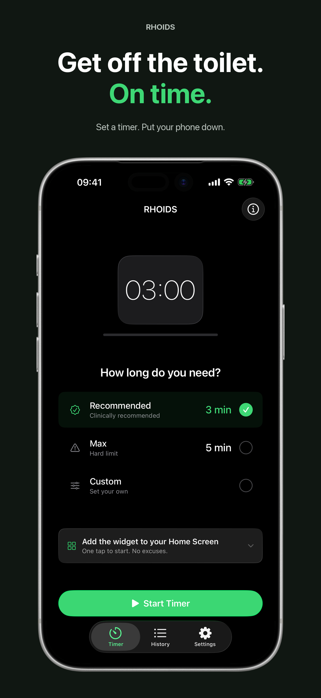
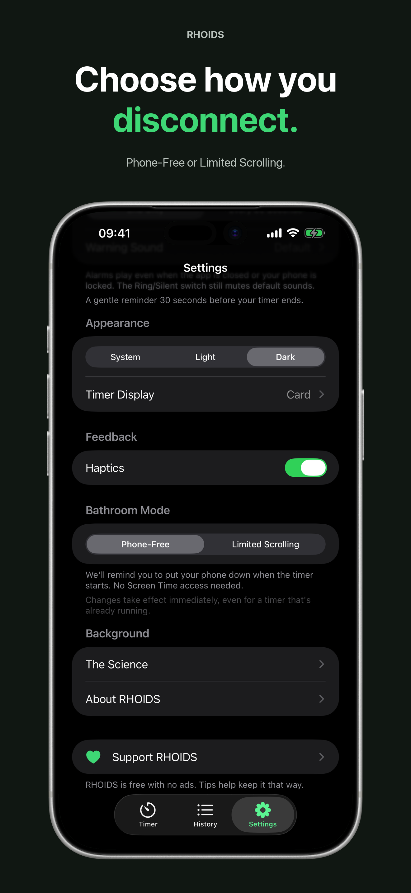
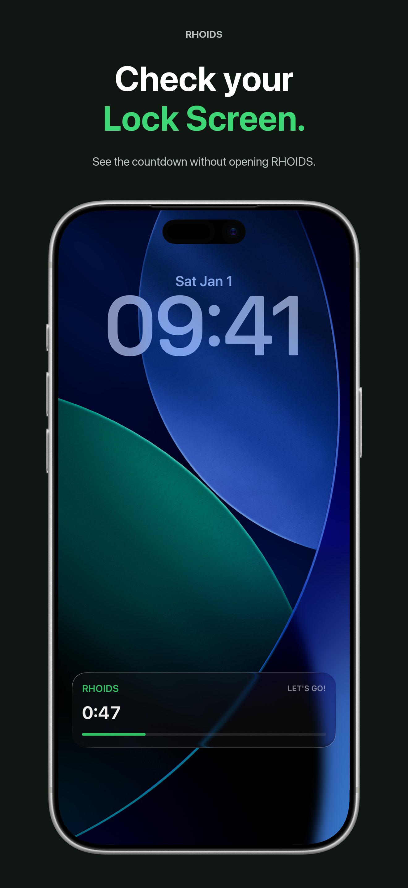
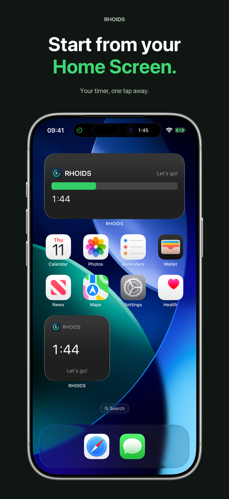
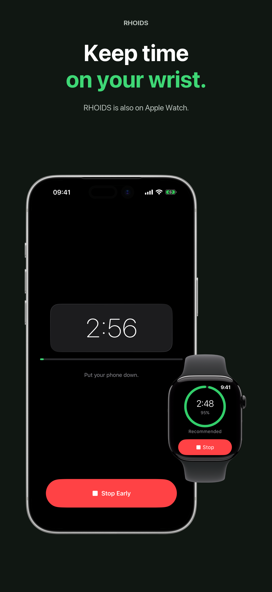
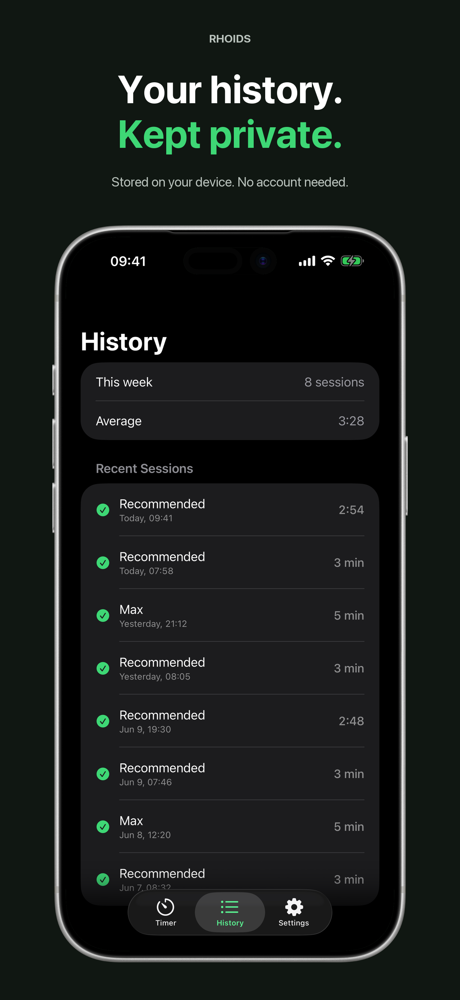

# RHOIDS

RHOIDS is a bathroom timer for iPhone and Apple Watch. It keeps toilet sessions short with research-informed presets, Lock Screen and watch controls, optional distraction blocking, and private on-device history.

## Why it exists

Phones turn a quick bathroom break into a long scrolling session. A [2025 PLOS One study](https://doi.org/10.1371/journal.pone.0329983) found an association between smartphone use on the toilet and a 46 percent higher risk of hemorrhoids among adults undergoing screening colonoscopy. RHOIDS turns that into one habit: start a short timer, put the phone down, and get on with your day.

RHOIDS is a behavior timer, not a medical device or medical advice. See a healthcare professional about persistent pain, bleeding, or other symptoms.

## Features

- Three-minute, five-minute, and custom timers
- Six timer visualizations with optional 30-second warnings
- AlarmKit completion alarms and local notifications
- Home Screen and Lock Screen widgets, Live Activities, Dynamic Island, Siri, and Apple Watch controls and complications
- Optional Focus Lock (Screen Time) for selected distracting apps
- Local session history and daily streaks
- StoreKit 2 tip jar
- 12 non-English localizations
- No accounts, advertising, analytics, or third-party dependencies

Requires iOS 26.0 or later and watchOS 26.0 or later.

## Screenshots

| iPhone | Bathroom mode | Live Activity |
|---|---|---|
|  |  |  |

| Widgets | Apple Watch | Private history |
|---|---|---|
|  |  |  |

The UI in these images comes from real app and simulator captures. Only the device frames and captions are marketing artwork. The full iPhone set is in [`AppStore/Screenshots/iphone-6.9`](AppStore/Screenshots/iphone-6.9), and the Apple Watch captures are in [`AppStore/Screenshots/masters-1320x2868/Watch`](AppStore/Screenshots/masters-1320x2868/Watch).

## Project layout

```text
Sources/
  RHOIDS/                    iPhone app
  RHOIDSWidget/              widgets and Live Activity
  RHOIDSWatch/               Apple Watch app
  RHOIDSWatchWidget/         watch complications
  RHOIDSDeviceActivityMonitor/
  RHOIDSShieldAction/        Screen Time extensions
  RHOIDSShieldConfiguration/
  Shared/                    cross-target models and services
  Connectivity/              phone/watch messages and preferences
Tests/
  RHOIDSTests/               iPhone and shared tests
  RHOIDSWatchTests/          watch app and complication tests
AppStore/                    listing copy and screenshots
qa/                          manual and release validation guides
scripts/                     project and verification tooling
project.yml                  XcodeGen source of truth
```

## Build

You need:

- macOS with Xcode 26 or later
- XcodeGen 2.45.4
- An Apple Developer team, for signed-device testing
- Family Controls entitlement approval, for Focus Lock on physical devices

`project.yml` defines the project. After changing targets, build settings, source membership, or versioning, regenerate the checked-in Xcode project:

```bash
xcodegen generate
open RHOIDS.xcodeproj
```

Select the `RHOIDS` scheme and an iPhone simulator. `RHOIDS.storekit` provides local StoreKit products.

### Configure a fork

The checked-in project keeps the identifiers of the shipping app. Before signing a fork:

1. Change `DEVELOPMENT_TEAM` and `bundleIdPrefix` in `project.yml`.
2. Replace each `PRODUCT_BUNDLE_IDENTIFIER` in `project.yml` with identifiers your team owns.
3. Replace `group.com.wesley.RHOIDS` in every entitlement file and in `Sources/Shared/SharedStateKeys.swift` with an App Group your team owns.
4. Run `xcodegen generate` and review the project diff.
5. Select your team in Xcode and confirm that every app and extension target signs.

## Tests

iPhone suite:

```bash
xcodebuild test \
  -project RHOIDS.xcodeproj \
  -scheme RHOIDS \
  -destination 'platform=iOS Simulator,name=iPhone 17 Pro'
```

Watch suite, on an available Apple Watch simulator:

```bash
xcodebuild test \
  -project RHOIDS.xcodeproj \
  -scheme RHOIDSWatchTests \
  -destination 'platform=watchOS Simulator,name=Apple Watch Series 11 (46mm)'
```

Simulator tests cannot verify AlarmKit presentation, Screen Time authorization and shielding, notification delivery, Live Activities, watch-to-phone behavior, signing, or App Store acceptance. These need a physical device and a signed build, and Focus Lock needs the Apple-granted Family Controls capability. The checklists in [`qa/`](qa) cover them.

## Privacy

RHOIDS has no accounts, advertising, analytics, or tracking. Timer preferences and session history stay on the device. Apple system services handle notifications, Screen Time, Live Activities, widgets, watch connectivity, and optional StoreKit purchases. See [PRIVACY.md](PRIVACY.md).

## Contributing and security

Read [CONTRIBUTING.md](CONTRIBUTING.md) before proposing changes. Report security or privacy concerns privately, as described in [SECURITY.md](SECURITY.md).

## License

The source code is available under the [MIT License](LICENSE). The RHOIDS name, app icon, screenshots, and App Store marketing artwork are not licensed for use as the identity of a redistributed app. Forks should use their own name and artwork.
